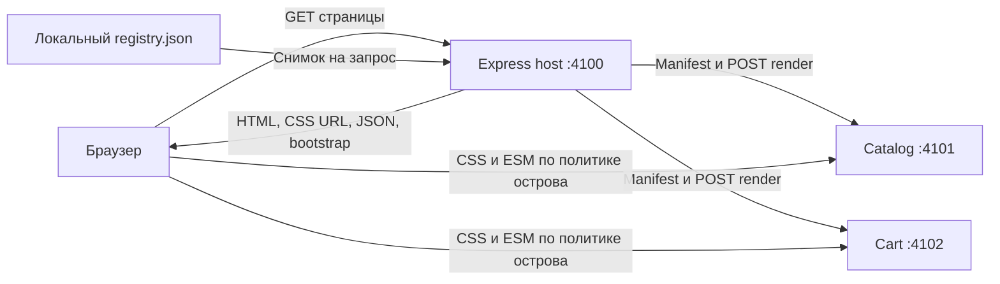

# Архитектура React SSR Islands

Описание реализованной системы на 2026-10-06.
Текущий статус находится в [PRODUCTION_HARDENING_STATUS.md](PRODUCTION_HARDENING_STATUS.md),
исходные проектные решения — в [архиве OpenSpec design](../openspec/changes/archive/2026-09-30-react-ssr-islands-microfrontends/design.md).
Основные спецификации после архивирования находятся в `openspec/specs/`;
дополнения текущего hardening — в `openspec/changes/production-hardening/specs/`.

## Общая схема

Express-хост собирает полный HTML из фрагментов независимых сервисов.
Браузер получает готовое содержимое и CSS, а JavaScript загружается для отдельных
интерактивных островов согласно их политикам. Оболочка страницы не гидратируется.



Граница между хостом и микрофронтендом — версионированный HTTP-контракт.
Хост не импортирует исходники или серверные сборки удалённых модулей.
Каждый модуль поставляет согласованную пару серверного и клиентского компонентов.

## Карта исходников

| Путь                                                                     | Ответственность                                                                    |
| ------------------------------------------------------------------------ | ---------------------------------------------------------------------------------- |
| `packages/contracts/src/index.ts`                                        | JSON-типы, runtime-валидация протокола, сериализация и экранирование               |
| `packages/server/src/render.ts`                                          | `defineIsland`, `defineFragment`, SSR, ID и проверка HTML-обёрток                  |
| `packages/server/src/service.ts`                                         | `createModuleService`, маршруты релизов, ресурсы, CORS, health/readiness           |
| `packages/server/src/registry.ts`                                        | `RegistryStore`, чтение снимков и последняя корректная конфигурация                |
| `packages/server/src/fetch.ts`                                           | `FragmentFetcher`, проверка origin, ограниченные HTTP-запросы                      |
| `packages/server/src/host.ts`                                            | `createHost`, параллельная композиция слотов и HTML-документ                       |
| `packages/server/src/compose.ts`, `html.ts`                              | Принадлежность DOM слотам, reserved IDs, локальная замена конфликтующих фрагментов |
| `packages/server/src/manifest-cache.ts`, `admission.ts`                  | Ограниченный immutable manifest cache, общие загрузки и квоты запросов             |
| `packages/contracts/src/integrity.ts`, `packages/server/src/releases.ts` | Inventory, publication marker и загрузка только проверенных релизов                |
| `packages/client/src/index.ts`                                           | `bootstrap`, `dispose`, политики и кеш импортов; без React в загрузчике            |
| `packages/client/src/react.ts`                                           | `createIslandEntry`, `useHydrated`, `hydrateRoot` и локальная граница ошибок       |
| `packages/rsbuild/src/index.ts`                                          | Раздельные Node/browser-сборки и генерация манифеста                               |
| `apps/host/src/`                                                         | Демонстрационная оболочка, слоты, конфигурация и браузерный bootstrap              |
| `apps/catalog/src/`                                                      | Каталог, фильтр, fragment renderer и клиентская точка входа                        |
| `apps/cart/src/`                                                         | Корзина с локальным счётчиком, fragment renderer и клиентская точка входа          |
| `scripts/build.ts`                                                       | Сборка приложений, сервисных launcher и production-supervisor                      |
| `scripts/service-entry.ts`                                               | Загрузка локальных релизов и запуск Express-сервиса модуля                         |
| `scripts/start.ts`                                                       | Запуск трёх приложений, ожидание готовности и остановка процессов                  |
| `scripts/dev.ts`                                                         | Наблюдение за исходниками, пересборка, перезапуск и SSE-перезагрузка               |

Это npm workspace с четырьмя пакетами и тремя приложениями.
Публичные пакеты названы `@islands/contracts`, `@islands/server`,
`@islands/client` и `@islands/rsbuild`.
React-адаптер клиента выделен в экспорт `@islands/client/react`.

## Путь серверного запроса

1. Хост выбирает зарегистрированный маршрут и фиксирует один снимок реестра.
   Реестр задаёт `moduleId → {releaseId, manifestUrl}` и проверяется целиком.
   Некорректное обновление сохраняет последний корректный снимок.
2. Для каждого слота создаются уникальный `instanceId`, JSON-props и разрешённый
   контекст. Все слоты запускаются параллельно.
3. Хост получает манифест, проверяет версию протокола, модуль, релиз и origin
   адреса рендеринга и ресурсов. Перенаправления запрещены.
4. Модулю отправляется render request. Renderer создаёт HTML отдельными вызовами
   `renderToString` для островов и возвращает дескрипторы.
5. Хост проверяет ответ, соответствие релиза, допустимые ключи островов,
   уникальность ID и соответствие дескрипторов HTML-обёрткам.
6. Оболочка получает HTML слотов. Хост добавляет CSS, безопасно сериализованный
   `application/json` payload и единственный bootstrap-скрипт.

Лимиты по умолчанию: 1500 мс на получение манифеста и рендеринг одного слота,
64 КиБ на манифест и 1 МиБ на render response. Разрыв клиентского соединения
отменяет незавершённые исходящие запросы. Повторных попыток внутри страницы нет.
Проверенные immutable manifests кешируются с LRU/TTL и ограничением bytes/count.
Одновременные потребители делят одну загрузку с независимой отменой. HTML, props
и request context не кешируются. Admission ограничивает global/per-module работу,
очередь и зарезервированные bytes; ожидание входит в deadline слота.
Настройки и ограничения приведены в [operations.md](operations.md).

После проверки отдельных фрагментов `composeSlots` проверяет итоговую структуру
DOM. Shell вызывается один раз; при конфликтах заменяются только отмеченные слоты.
Это отдельная проверка: корректные по отдельности фрагменты могут конфликтовать
после объединения. Количество проходов ограничено числом слотов плюс один.

Отказ слота даёт его резервное содержимое при статусе страницы 200;
неизвестный маршрут — 404, ошибка оболочки — 500. Страницы используют `no-store`.
Readiness хоста проверяет реестр и обязательные локальные файлы, а не доступность
удалённых модулей. `/healthz` проверяет работоспособность процесса.

## Контракты релиза и острова

Основные структуры:

```text
Manifest:
  protocolVersion, moduleId, releaseId, reactVersion, renderUrl
  islands[islandKey] = { clientEntryUrl, cssUrls }

RenderRequest:
  protocolVersion, moduleId, releaseId, instanceId, props, context

RenderResponse:
  protocolVersion, moduleId, releaseId, html, islands

IslandDescriptor:
  id, islandKey, props, policy, identifierPrefix
```

Публичный серверный API — `defineIsland(key, Component, policy)` и
`defineFragment((builder, request) => html)`. Метод `builder.island` возвращает
обёртку острова, `builder.static` — статический HTML.
Компоненты получают данные как `{data: props}`, включая скалярные JSON-значения.
Вложенные объявления островов и вложенные обёртки отклоняются.

SSR и клиентская гидратация используют одинаковые компонент, props и уникальный
`identifierPrefix`. Это сохраняет соответствие начальной разметки и результатов
`useId()` у повторных экземпляров. Данные подготавливаются до синхронного SSR.

## Браузерная часть

`bootstrap` читает `#islands-payload` или принимает массив дескрипторов.
Хост добавляет к дескриптору идентичность модуля/релиза и проверенный `clientEntryUrl`.
Браузерный entry экспортирует
`hydrate(element, props, {identifierPrefix, onError})`, возвращающий функцию очистки.

| Политика  | Момент запуска                                                   |
| --------- | ---------------------------------------------------------------- |
| `load`    | Сразу при bootstrap                                              |
| `visible` | Первое пересечение viewport; без `IntersectionObserver` — сразу  |
| `idle`    | `requestIdleCallback` с timeout 2000 мс; без API — таймер 200 мс |
| `never`   | Только HTML и CSS; импорт и React root не создаются              |

Promises импортов кешируются по URL, состояние экземпляров — по ID внутри Document.
Каждый Document хранит active states и отметки использованных ID; документы
разделены через WeakMap. При dispose удаляются DOM/root/callback references.
Повторный bootstrap не создаёт второе корневое дерево.
`dispose` отменяет ожидание, размонтирует активное дерево и оставляет отметку
об освобождённом ID. Поздний импорт не гидратирует освобождённый или удалённый контейнер.

`useHydrated()` включает controls после первого клиентского рендера.
Ошибка импорта сохраняет SSR и помечает остров недоступным.
Ошибка рендера обрабатывается локальной границей ошибок; mismatch фиксируется
через `onRecoverableError`. Между корневыми деревьями нет общего React-контекста.
Каждый микрофронтенд включает свою пару React/React DOM; общие chunks допустимы
только внутри его сборки. Стили компонентов используют CSS Modules.

В демонстрации каталог `load` соседствует с независимым экземпляром `idle`
и статическим экземпляром `never`. Корзина `visible` расположена ниже viewport.

## Сборка и развёртывание

Rsbuild собирает ESM для Node и браузера раздельно.
Адаптер получает `releaseId`, создаёт манифест по фактическим outputs и проверяет
полный inventory server/browser ресурсов. До сборки release ID эксклюзивно
резервируется; сборка и проверки выполняются в staging. Публикация — atomic rename
на том же volume после проверки renderer, inventory и publication marker.
Существующий каталог релиза не перезаписывается; failed ID не используется повторно.
Для приложений итоговая структура имеет следующий вид:

```text
apps/<module>/dist/
  package.json
  server.mjs                  # launcher Express-сервиса
  .reservations/<releaseId>/   # использованный ID, включая failed builds
  .staging/<transactionId>/    # незавершённые комплекты вне serving tree
  releases/<releaseId>/
    manifest.json             # публичный протокол
    integrity.json            # полный inventory bytes/SHA-256
    published.json            # identity и digest inventory
    server/server.mjs         # SSR конкретного релиза
    server/emitted-manifest.json
    assets/
      manifest.json           # список outputs Rsbuild
      static/js/              # ESM entries и chunks
      static/css/             # CSS

apps/host/dist/
  package.json
  server.mjs
  registry.sample.json        # пример, создаваемый сборкой
  registry.json               # внешняя конфигурация оператора, либо REGISTRY_PATH
  assets/bootstrap.js

dist/start.mjs                # общий production-supervisor
```

Launcher модуля загружает только marked, проверенные релизы при старте и обслуживает
`/releases/<releaseId>/manifest.json`, `/render`, `/readyz` и `/assets/*`.
Повреждённый marked release даёт 503, неизвестный — 404; исправные соседи остаются
доступны. Общая readiness сообщает о любом повреждённом marked release.
Проверка повторяется после конечного интервала, одновременные запросы делят один
Promise проверки. Релиз и его checked/valid/pending хранятся одной записью.
Новый релиз публикуется рядом со старым, сервис модуля перезапускается, затем
реестр хоста атомарно заменяется. Уже выполняющиеся запросы и открытые страницы
остаются привязаны к своим релизам. Откат меняет запись реестра обратно.
Хост и соседние модули пересобирать не требуется.

Ресурсы и манифесты отдаются с immutable-кешированием, MIME и CORS.
Для независимого production-запуска достаточно deploy-каталога приложения и Node;
зависимости демонстрационных приложений включены в сборки.
Сохранение старых релизов и их удаление контролирует оператор.

В режиме разработки `scripts/dev.ts` использует общий скрипт сборки: готовит новый
`dev-<UUID>` в отдельной `.cache/dev/generation-*` при работающей предыдущей версии.
Только после успешной сборки выполняет короткий restart и смену поколения;
ошибка сборки сохраняет last-known-good. Production registry/releases не меняются.
Страница полностью перезагружается по SSE
с порта 4103. Это пересборка и перезапуск, а не HMR с сохранением состояния.

## Границы доверия и принятые решения

- HTTP-композиция обеспечивает независимость модулей без Module Federation,
  загрузки удалённого Node-кода в хост или общего React singleton.
- Один снимок реестра и versioned URL связывают HTML, props, CSS и JS одного релиза.
- URL выбираются из серверной конфигурации и проверенного манифеста, не из props.
- Props принимают только обычные JSON-значения. Сериализация экранирует HTML-символы
  и Unicode-разделители; атрибуты экранируются отдельно.
- HTML приходит от доверенных сервисов. Проверка обёрток и запрет script-тегов
  не превращают систему в песочницу для недоверенных авторов.
- Cookies и Authorization автоматически не передаются. Контекст ограничен
  списком разрешённых полей. Диагностика содержит идентификаторы и категорию,
  но не props, credentials или исходные исключения.
- Дополнительный HTTP-запрос и отдельная копия React у каждого модуля — принятые
  издержки независимости. Хост буферизует HTML; streaming не реализован.

В границы v1 не входят вложенные острова, SPA-router, React Server Components,
Suspense/streaming, ранний replay событий, бизнес-авторизация, общий бизнес-store,
облачная инфраструктура и автоматическая очистка старых релизов.
Проверки и измеренные размеры приведены в [acceptance.md](acceptance.md).

## Граница runtime и эксплуатационных инструментов

Ядро проекта — четыре пакета contracts/server/client/rsbuild и приложения,
использующие их API. Qualification profiles, load harness, dependency reports,
retention calculation и offline migration находятся отдельно в `scripts/`;
они не входят в путь запроса или browser bootstrap. Service authentication и
security headers защищают deployment boundary, а не реализуют login приложения.

Локальная разработка использует demo/dev. Target profiles и процедуры допуска
нужны при подготовке конкретной среды; локальный запуск не требует выдуманных SLO
или production owners. Удаление этих инструментов не упростило бы runtime.
Результаты ревью и внесённые упрощения: [SIMPLIFICATION_REVIEW.md](SIMPLIFICATION_REVIEW.md).
